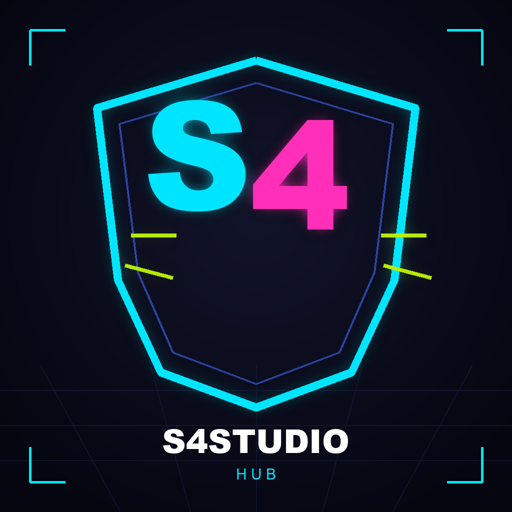

# S4Studio — Public Tester Program

**One desktop hub. Every part of your S4 League private server.**

| Repository | What it is | Who it is for |
|---|---|---|
| **[S4Studio](https://github.com/Suplic0z05/S4Studio)** *(development hub)* | Full source, architecture, complete technical documentation, changelog channels | Developers, contributors |
| **S4Studio-Pubblic-Test-** *(you are here)* | Sealed alpha/beta builds, signed 1-week tester keys, bug reports | Beta testers, server owners |

---

## What you'll be able to do

The full spec lives on the development repo — no spoilers here. The short version, as **outcomes**
you will actually get on day one:

- 🎛 **Run your whole server from one window** — start, stop, watch, fix. No scattered tools.
- 🧰 **Edit game content safely** — open, change and restore game resources with automatic backups
  at every step. If something goes wrong, you roll back.
- 🌐 **Give your server a face** — a website for your players with status, leaderboard, shop and
  news, plus a proper admin console.
- 🗄 **Own your data** — players, currency, bans, backups: done in the app, not in random SQL shells.
- 📦 **Share and install content** — mod packages with integrity checks and one-click restore.
- 🤖 **Get a real assistant** — an AI that knows S4 League, does useful actions for you, and logs
  everything it does.
- 🌙 **And much more** — automations, multi-season fleet control, Discord integration… the
  complete list (with evidence) is on the main repo.

Every one of these is backed by **776 automated tests + a 102-scenario E2E harness** — this is a
serious project, not a weekend script.

## Why join the beta

- 🚀 **First access** — you run builds before anyone else, with changelogs
- 🧭 **Real influence** — your reports go straight into the roadmap, not into a void
- 🏅 **Credit** — findings that lead to fixes are credited in the release notes
- ⭐ **Stars** — the project is growing: early testers who help it take shape are the reason it
  earns its community stars, and their names ride along with it
- 🎓 **Zero setup knowledge required** — the first-run wizard only asks for two folders, and the
  installer downloads and hash-verifies the official runtimes (.NET, MariaDB) by itself

## How to become a tester

> **Downloads today vs tester beta.** A first **stable alpha build** (no tester key needed) is
> already published on the [main repo Releases](https://github.com/Suplic0z05/S4Studio/releases/tag/v0.0.0.1-alpha).
> The **key-gated beta builds** of this program are not published yet — you can apply now:
> licenses are assigned and the first wave gets access at the beta release.

*▲ Live download button — the team reserved a special response for early clickers.*

1. Open an issue here with the **Tester application** template (top-right **New issue**) — tell us
   your Windows version, which client/season you own, what you want to test and your weekly time.
2. If accepted you receive a personal **license key** (`S4T1.….…`).
3. When the **key-gated beta** is published here: download `S4StudioSetup.exe` from
   **Releases**. The installer picks the path, downloads the official runtimes verifying their
   hashes, extracts the app and **seals** it (integrity manifest). Same installer, beta channel:
   this one starts **only with a valid tester key**.
4. On first launch enter your key: without a valid key (not expired, not revoked) **the app does
   not start**.

## Tester keys — 1 week, then everything goes

- Your personal key lasts **1 week**.
- When it expires, the **beta build removes itself from the machine**: the application and every
  file and structure it created (including its sealed data) are deleted, so **no project file is
  recoverable from that computer** — until you decide to support the work and get a new key.
- The **first keys are free**, but only for a **limited number of spots**; once those are taken,
  keys require supporting the work (contribution).
- Keys remain team-signed (RSA-3072) and revocable at any time. Revoked = immediate lockout and
  purge on next launch.

## What to test (in priority order)

1. **Installation** (installer, first launch, wizard) and **database setup** (MariaDB with the
   official hash)
2. **Database**: connection, schema, players, backups
3. **Shop Wizard** and `shop.check` (client ↔ DB item consistency)
4. **Client**: opening game resources, preview, extraction, import, save with backup
5. **Web Admin Console**: login, TOTP, commands
6. Anything else: open an **Issue** with logs (data folder → `Data/machine/logs`)

## Tester rules

- The key is personal: do not share it (it is tracked and can be revoked)
- No anti-cheat is ever touched: the project contains no cheat/inject features
- Test only on servers/databases you own or are authorized to use
- One issue per problem, logs only — **never paste passwords, tokens or AI keys**

## Build integrity

- Builds are **sealed**: `installation-manifest.json` with a SHA-256 per file and a protected
  digest — the installer verifies it, the app refuses altered files
- Licenses are **cryptographically signed** (RSA-3072): altering or extending a key without the
  team key is mathematically infeasible

*Full technical documentation, source and changelog:
[Suplic0z05/S4Studio](https://github.com/Suplic0z05/S4Studio) ·
alpha channel · © team S4Studio — reserved for authorized testers*

