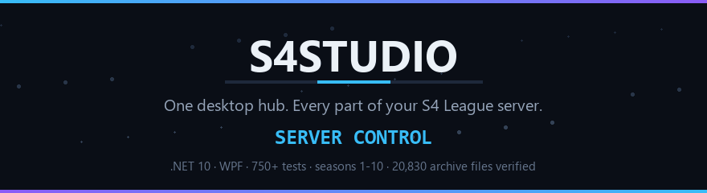
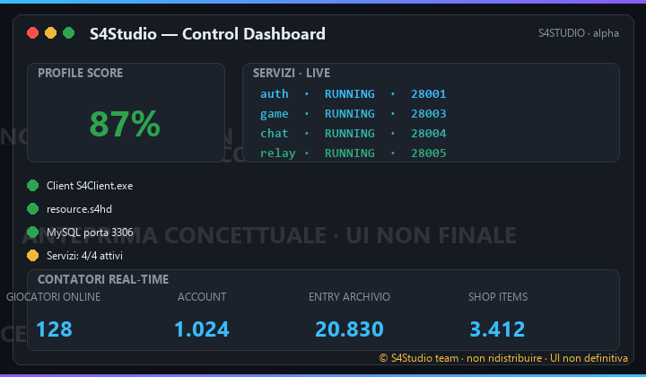
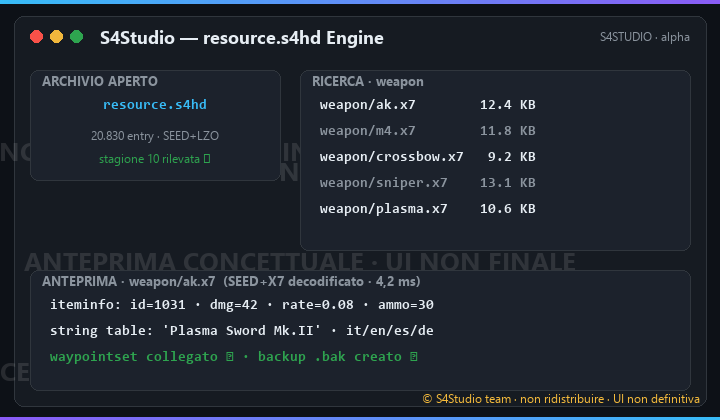
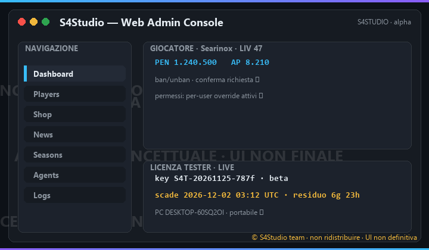
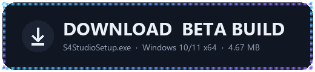

# S4Studio — Public Tester Program

**One desktop hub. Every part of your S4 League private server.**

| Repository | What it is | Who it is for |
|---|---|---|
| **[S4Studio](https://github.com/Suplic0z05/S4Studio)** *(development hub — team only)* | Full source, architecture, complete technical documentation, changelog channels | Team, contributors with access |
| **S4Studio-Pubblic-Test-** *(you are here)* | Sealed alpha/beta builds, signed 1-week tester keys, bug reports | Beta testers, server owners |

---

## What you'll be able to do

The full spec lives on the development repo — no spoilers here. The short version, as **outcomes**
you will actually get on day one:

- 🎛 **Run your whole server from one window** — start, stop, watch, fix. No scattered tools.
- 🧰 **Edit game content safely** — open, change and restore game resources with automatic backups
  at every step. If something goes wrong, you roll back.
- 🌐 **Give your server a face** — a website for your players with status, leaderboard, shop and
  news, plus a proper admin console.
- 🗄 **Own your data** — players, currency, bans, backups: done in the app, not in random SQL shells.
- 📦 **Share and install content** — mod packages with integrity checks and one-click restore.
- 🤖 **Get a real assistant** — an AI that knows S4 League, does useful actions for you, and logs
  everything it does.
- 🌙 **And much more** — automations, multi-season fleet control, Discord integration… the
  complete list (with evidence) is on the main repo.

Every one of these is backed by **876 automated tests + a 119-scenario E2E harness** — this is a
serious project, not a weekend script.

## Concept previews — what to expect

   
   
  

> **These are concept previews, not final screenshots.** The interface, colours and animations are
> still being decided, so the shipped build will look different. Every image is watermarked and
> published at reduced fidelity on purpose: they are here so you know what to expect before asking
> for a key, **not** as assets to extract, copy or reuse. Please don't republish them.

## Why join the beta

- 🚀 **First access** — you run builds before anyone else, with changelogs
- 🧭 **Real influence** — your reports go straight into the roadmap, not into a void
- 🏅 **Credit** — findings that lead to fixes are credited in the release notes
- ⭐ **Stars** — the project is growing: early testers who help it take shape are the reason it
  earns its community stars, and their names ride along with it
- 🎓 **Zero setup knowledge required** — the first-run wizard only asks for two folders, and the
  installer downloads and hash-verifies the official runtimes (.NET, MariaDB) by itself

## How to become a tester

> **Key-gated beta only.** Every build published here requires a **personal tester key**:
> **1 week of use**, then the build removes itself from the machine. Apply now with the
> *Tester application* template — the first keys are free, for a limited number of spots.
> There is no ungated download in this program: the public channel ships key-protected builds only.

*▲ The button opens the Releases page. Builds there are key-gated: apply for a key first (below),
then download `S4StudioSetup-beta.exe` from the latest tester release.*

1. Open an issue here with the **Tester application** template (top-right **New issue**) — tell us
   your Windows version, which client/season you own, what you want to test and your weekly time.
2. If accepted you receive a personal **license key** (`S4T1.….…`).
3. When your key is issued: download `S4StudioSetup-beta.exe` from the latest release in
   **Releases here**. The installer asks for the path, makes you **accept the usage license**
   (it states the definitive deletion at expiry), then **asks for your key and verifies it before
   downloading anything**; only then it downloads the official runtimes (hash-verified), extracts
   the app and **seals** it (integrity manifest).
4. The build starts **only with a valid tester key** and works for the duration of that key
   (1 week). Without a valid key (missing, expired, revoked, already consumed) **the app does not
   start**.

## Tester keys — 1 week, then everything goes

- Your personal key lasts **exactly 1 week** (the signed expiry date is authoritative — regular
  use does not extend it).
- The key is **single-use**: it activates exactly one installation and it is also the
  **self-destruct key** of the build — it can never be reused. Expired, revoked or consumed:
  nothing is recoverable, and continuing requires a **brand-new key from the team**.
- When it expires, the **beta build removes itself from the machine**: after a 20-second
  countdown (you can only postpone it to the next launch), the application, its sealed data and
  **every artifact the app derived** (package backups in `.s4studio-backup`, `.bak` config copies,
  reports) are deleted, so **no project file is recoverable from that computer** — until you
  decide to support the work and get a new key. Your **original game client and the sources** you
  asked the app to analyze are **never touched**.
- The **first keys are free**, but only for a **limited number of spots**; once those are taken,
  keys require supporting the work (contribution).
- Keys are team-signed (RSA-3072) and can be revoked at any time. Honest limit: revocation takes
  effect **at the next launch** after the team-updated revocation list reaches your app — without
  online verification (next step) the block is not sub-second; the signed expiry date always is.

## What to test (in priority order)

1. **Installation** (installer, first launch, wizard) and **database setup** (MariaDB with the
   official hash)
2. **Database**: connection, schema, players, backups
3. **Shop Wizard** and `shop.check` (client ↔ DB item consistency)
4. **Client**: opening game resources, preview, extraction, import, save with backup
5. **Web Admin Console**: login, TOTP, commands
6. Anything else: open an **Issue** with logs (data folder → `Data/machine/logs`)

## Tester rules

- The key is personal: do not share it (it is tracked and can be revoked)
- No anti-cheat is ever touched: the project contains no cheat/inject features
- Test only on servers/databases you own or are authorized to use
- One issue per problem, logs only — **never paste passwords, tokens or AI keys**

## License, cloning and reuse

- This repository is **not open source**. It exists to distribute key-gated tester builds that
  support the original project, and nothing else: see [`LICENSE`](LICENSE).
- **No source code is published here.** Cloning this repository gives you the README, the license,
  the preview images and the issue templates — not a reusable project.
- Reuse, redistribution, forks used to ship builds, and reverse engineering of the sealed payload
  are **not licensed**. Keys are personal, single-use and revocable, so a leaked or shared key
  stops working for everyone who receives it.
- Honest limit: any public Git repository can be **technically** cloned — no license or repository
  setting changes that. What protects the project is the combination of this license, the absence
  of source, and the fact that a build **does not run** without a valid team-signed key.
- If you find an unauthorized copy, a leaked key or a mirrored build, report it privately: leaked
  keys are revoked and the copy is taken down.

## Build integrity

- Builds are **sealed**: `installation-manifest.json` with a SHA-256 per file and a protected
  digest — the installer verifies it, the app refuses altered files
- Licenses are **cryptographically signed** (RSA-3072): altering or extending a key without the
  team key is mathematically infeasible

*Full technical documentation, source and changelog:
[Suplic0z05/S4Studio](https://github.com/Suplic0z05/S4Studio) ·
alpha channel · © team S4Studio — reserved for authorized testers*

