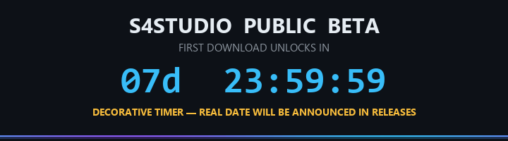

# S4Studio — Public Tester Program

**One desktop hub. Every part of your S4 League private server.**

*This repository hosts **only the test build** — the source lives in the private team repo,
with the public project page at [Suplic0z05/S4Studio](https://github.com/Suplic0z05/S4Studio).*

---

## What the S4Studio hub actually does

S4Studio is not a collection of loose scripts: it is a single WPF application (.NET 10, MVVM,
dark theme) that brings every piece of an S4 League private server into one controlled place —
and every module talks to the others in real time through an internal event bus.

| Area | What you get |
|---|---|
| 🎛 **Control Dashboard** | A 0–100 validation score of your whole profile: client checks, sources, database reachability, services status, players online, archive entries — at a glance |
| 🖥 **Server Control** | Start / stop / restart every service individually or all at once, live console with stdout/stderr, automatic command detection (`auth.bat`, `game.bat`, `dotnet run`, server DLLs), build & restore of your sources from inside the app |
| 🎮 **Client & Seasons** | Edition detection with confidence and evidence from `version.dat` (Season 1→10, S4Apex/S4Dinasty/S4Violet/S4Legion/vFun, region, index variant), archive fingerprint, client launch with plugin notifications |
| 🗜 **resource.s4hd Engine** | Native, faithful implementation of the S4 archive format (SEED/SIC + rotating XOR, OldCapped32, LZO, X7 wrapper + CRC): search, text preview, single-file or full extraction, import, save with automatic `.bak` — **verified against a real Season 10 client with 20,830 files** |
| 🗄 **Database Center** | MySQL & PostgreSQL: connection test, table introspection, free SQL queries, player search by nickname, PEN/AP editing, ban/unban with confirmation, backups via `mysqldump`/`pg_dump` with logical fallback |
| 📦 **Packages (.s4mod)** | Create mod packages from client files or archive entries, install with SHA-256 verification, confirm-and-backup flow, one-click restore |
| 🧩 **Plugin System** | Isolated `AssemblyLoadContext` host with hot reload, sample-plugin generator, hooks (`OnClientLaunching`, `OnServerStarted`, …), plugin API routes and widgets served on the web dashboard — a crashing plugin never takes down the hub |
| 🤖 **AI Assistant** | S4-domain-only chat with six typed tools (`server_status`, `start_service`, `find_player`, `resource_search`, `db_stats`, …), local knowledge index, honest offline mode, full audit log. Autopilot modes from *Observe* to *Autonomous* — high-risk actions stay locked, always |
| 🌐 **Web Dashboard** | A complete local site: homepage with live status, leaderboard, shop, news, plugin widgets — plus a JSON API and a dedicated Admin Console with TOTP login and granular per-user permissions |
| ⚙️ **Automation & Ops** | Multi-season server fleet with map rotation and crash-loop guard, music/item/map import pipelines, Discord Rich Presence, UPnP port opening, scheduled backups, metric history, webhook alerts |

Everything destructive asks for confirmation. Everything sensitive (DB passwords, admin tokens,
AI keys) is encrypted with DPAPI. Everything the app writes goes through a path guard — no
arbitrary writes, ever. BattlEye and anti-cheat are **never touched**: no inject, no cheats.

**In numbers:** 14 projects · 750+ automated tests in both Release and Debug · 100+ scenario E2E
harness · 71 internal design/ops documents · seasons 1–10 supported.

## Why join the beta

- 🚀 **First access** — you run builds before anyone else, with changelogs
- 🧭 **Real influence** — your reports go straight into the roadmap, not into a void
- 🏅 **Credit** — findings that lead to fixes are credited in the release notes
- ⭐ **Stars** — the project is growing: early testers who help it take shape are the reason it
  earns its community stars, and their names ride along with it
- 🎓 **Zero setup knowledge required** — the first-run wizard only asks for two folders, and the
  installer downloads and hash-verifies the official runtimes (.NET, MariaDB) by itself

## How to become a tester

> **⚠ Beta not ready for download yet.** The Releases section is still empty: the beta build
> will be published here only once it passes the team's stability checks. You can apply now —
> licenses are assigned and the first wave gets access at release.

1. Open an issue here with the **Tester application** template (top-right **New issue**) — tell us
   your Windows version, which client/season you own, what you want to test and your weekly time.
2. If accepted you receive a personal **license key** (`S4T1.….…`): time-limited (**1 week**),
   tracked, limited in number.
3. When the beta is published: download `S4StudioSetup.exe` from **Releases**. The installer picks
   the path, downloads the official runtimes verifying their hashes, extracts the app and **seals**
   it (integrity manifest).
4. On first launch enter your key: without a valid key (not expired, not revoked) **the app does
   not start**.
5. After expiry the app deactivates itself — no project file is recoverable through it. To keep
   testing, support the work and get a new key (the first free spots are limited).

## Tester keys — 1 week, then your choice

- Your personal key lasts **1 week**.
- When it expires the app deactivates itself: **no project file or data is recoverable through
  it** — until you decide to support the work and get a new key.
- The **first keys are free**, but only for a **limited number of spots**; once those are taken,
  keys require supporting the work (contribution).
- Keys remain team-signed (RSA-3072) and revocable at any time.

## What to test (in priority order)

1. **Installation** (installer, first launch, wizard) and **database setup** (MariaDB with the
   official hash)
2. **Database**: connection, schema, players, backups
3. **Shop Wizard** and `shop.check` (client ↔ DB item consistency)
4. **Client**: opening `resource.s4hd`, preview, extraction, import, save with backup
5. **Web Admin Console**: login, TOTP, commands
6. Anything else: open an **Issue** with logs (data folder → `Data/machine/logs`)

## Tester rules

- The key is personal: do not share it (it is tracked and can be revoked)
- No anti-cheat is ever touched: the project contains no cheat/inject features
- Test only on servers/databases you own or are authorized to use
- One issue per problem, logs only — **never paste passwords, tokens or AI keys**

## Build integrity

- Builds are **sealed**: `installation-manifest.json` with a SHA-256 per file and a protected
  digest — the installer verifies it, the app refuses altered files
- Licenses are **cryptographically signed** (RSA-3072): altering or extending a key without the
  team key is mathematically infeasible

*Project: [Suplic0z05/S4Studio](https://github.com/Suplic0z05/S4Studio) · alpha channel ·
© team S4Studio — reserved for authorized testers*

